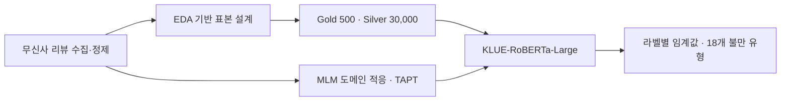

# 패션 리뷰의 숨은 불만 탐지

**고평점 리뷰에도 섞여 있는 불만을 찾아, 18개 세부 유형으로 분류하는 한국어 NLP 프로젝트입니다.**

2026-1 텍스트마이닝 · 5인 팀 프로젝트 · Python / PyTorch / Hugging Face Transformers

무신사 리뷰 391,182건의 수집·정제에서 출발해, LLM 약지도 라벨링과 KLUE-RoBERTa-Large 학습을 연결했습니다. 이 저장소는 모델 학습·평가를, [musinsa_crawler](https://github.com/riex71/musinsa-review-pipeline)는 데이터 수집·정제를 담당합니다.

**본인 기여:** 데이터 수집·처리, 모델링 또는 분석 구현, 실험과 결과 정리 전반을 주도했습니다. 팀 공동 참여 프로젝트입니다.

## 해결한 문제

별점이 높아도 사이즈, 마감, 소재에 대한 불만이 함께 나타납니다. 별점이나 긍·부정 감정만으로 판단하면 이런 신호를 놓칩니다. 리뷰 본문을 기준으로 불만의 존재와 유형을 함께 다루고, 한 리뷰에 여러 불만이 붙을 수 있도록 multi-label 문제로 정의했습니다.

## 접근 방법



- **데이터 설계:** 고평점 속 부분 불만, 저평점, 혼합 표현을 고려해 표본을 구성했습니다.
- **약지도 학습:** Qwen3.5 9B 기반 silver label을 학습에, 팀 교차 검토로 확정한 gold 500건을 평가에 사용했습니다.
- **모델 비교:** TF-IDF 기반 coarse 8-label 기준선을 확인한 뒤, fine 18-label 분류와 도메인 적응을 실험했습니다.
- **오류 보정:** 라벨별 임계값으로 precision/recall 균형을 조정했습니다.

## 결과와 평가 조건

아래는 최종 발표 자료에 기록된 **동일한 fine 18-label 과제**의 결과입니다. 이번 문서 정리에서 모델을 재학습하거나 성능을 재측정하지 않았습니다.

| 설정 | Micro F1 | Macro F1 | Subset accuracy |
|---|---:|---:|---:|
| Fine-tuning, 임계값 0.5 | 0.7368 | 0.6978 | 0.796 |
| Fine-tuning + 라벨별 임계값 | 0.7741 | 0.7560 | 0.816 |
| TAPT + Fine-tuning, 임계값 0.5 | 0.7403 | 0.6326 | 0.796 |
| TAPT + Fine-tuning + 라벨별 임계값 | **0.7977** | **0.8030** | **0.838** |

**해석:** TAPT 단독으로 모든 지표가 좋아지지는 않았습니다. 최종 결과는 TAPT와 라벨별 임계값을 함께 적용한 설정의 관측값입니다. Gold 500건을 임계값 탐색과 평가에 함께 사용했으므로, 위 수치는 독립 테스트셋 일반화 성능으로 해석할 수 없습니다.

TF-IDF + LinearSVC의 Micro F1 0.540은 coarse 8-label 과제의 값입니다. 위 fine 18-label 결과와 직접적인 성능 향상률을 계산하지 않습니다.

에이블리 25,808건·지그재그 40,684건에도 예측을 적용해 사례를 검토했습니다. 외부 플랫폼에는 gold label이 없어 정량적인 전이 성능은 확인하지 못했습니다.

## 코드 살펴보기

| 단계 | 코드 |
|---|---|
| 학습·평가 데이터 구성 | [prepare_fine_data.py](src/prepare_fine_data.py) |
| Fine-tuning | [train_fine.py](src/train_fine.py) |
| 리뷰 도메인 적응 | [run_tapt.py](src/run_tapt.py) |
| TAPT 이후 분류 학습 | [train_fine_from_tapt.py](src/train_fine_from_tapt.py) |
| 임계값 탐색·적용 | [tune_threshold_fine_from_tapt.py](src/tune_threshold_fine_from_tapt.py), [apply_labelwise_threshold_fine_from_tapt.py](src/apply_labelwise_threshold_fine_from_tapt.py) |
| 외부 플랫폼 적용 | [predict_external_platforms.py](src/predict_external_platforms.py) |

## 실행

저장소 루트에서 프로젝트 환경을 설치합니다. Python 요구 버전과 의존성은 [pyproject.toml](pyproject.toml) 및 [uv.lock](uv.lock)을 따릅니다.

```bash
uv sync
```

준비된 `data/train_fine.csv`, `data/eval_fine.csv`로 기본 분류기를 학습하려면:

```bash
uv run python src/train_fine.py
```

TAPT 경로는 별도로 준비한 `data/musinsa_train_ready.csv`의 `content_norm` 열이 필요합니다. 해당 코퍼스는 현재 저장소 파일 목록에 포함되어 있지 않습니다.

```bash
uv run python src/run_tapt.py
uv run python src/train_fine_from_tapt.py
uv run python src/tune_threshold_fine_from_tapt.py
uv run python src/apply_labelwise_threshold_fine_from_tapt.py
```

학습 데이터에는 `sample_id`, `content_norm` 및 코드에 정의된 18개 이진 라벨 열이 필요합니다. 원본 silver/gold 통합 파일에서 분리하려면 `data/silverset.csv`를 준비한 뒤 `src/prepare_fine_data.py`를 실행합니다. 스크립트는 고정 출력 경로를 사용하므로 재실행 시 기존 학습 결과를 확인해야 합니다.

## 한계와 다음 검증

- 임계값 조정용 validation과 최종 test를 분리해 일반화 성능을 다시 평가해야 합니다.
- 약지도 라벨의 오류와 `fit_dissatisfaction`, `design_mismatch` 같은 해석형 라벨의 모호성이 남아 있습니다.
- 라벨러 간 정량적 일치도와 외부 플랫폼 gold 기반 평가는 확보하지 못했습니다.
- 데이터 이용 범위는 코드 공개와 별도로 검토해야 합니다. 리뷰 원문의 자유로운 재배포를 허용하는 저장소로 해석하지 않습니다.

결과의 출처는 「26-1 텍스트마이닝 4조 최종발표」입니다. 표의 값은 팀 프로젝트 결과이며 개인 기여 범위를 의미하지 않습니다.
